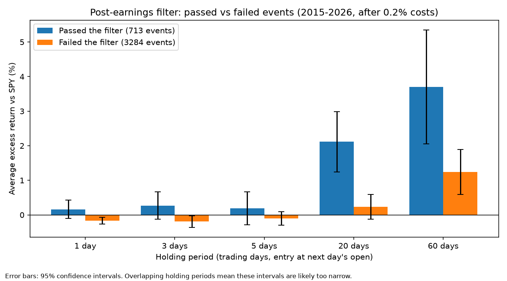

# Earnings Momentum Backtester

**Question:** Do stocks that gap up strongly on earnings, hold the move, and trade on heavy volume keep outperforming afterwards?

I built this to test the post-earnings rules from my own trading process with data, rather than trusting them.

## The rules tested
A stock "passes the filter" on its earnings reaction day if all three hold:
1. **Gap:** reaction-day open is at least 2% above the previous close
2. **Gap held:** reaction-day close is at or above the open
3. **Volume:** reaction-day volume is at least 2x the average of the previous 20 days

## Method
- **Universe:** ~4,000 earnings events across 100 US stocks, 2015–2026
- **No look-ahead in entries:** trades enter at the next day's open, so every signal uses only information available at entry
- **Costs:** 0.2% round-trip
- **Benchmark:** every trade measured relative to the S&P 500 (SPY)
- **Holding periods:** 1, 3, 5, 20 and 60 trading days
- **Statistics:** one-sample t-tests, and Welch two-sample t-tests comparing events that pass the filter with events that fail it
- **Robustness:** a 9-setting sensitivity grid around the thresholds, and a split-sample check (2015–21 vs 2022–26)
- **Verification:** 21 calculated values across 3 trades hand-checked against source prices (21/21 matched)

## Results
Average excess return vs SPY (after 0.2% costs), events that passed the filter vs events that failed it:

| Hold | Passed (t vs zero) | Failed | Difference (Welch t) |
|---|---|---|---|
| 1 day | +0.16% (1.20) | -0.17% | +0.33% (2.30) |
| 3 days | +0.27% (1.33) | -0.19% | +0.47% (2.12) |
| 5 days | +0.19% (0.80) | -0.10% | +0.30% (1.13) |
| 20 days | +2.11% (4.74) | +0.23% | +1.88% (3.90) |
| 60 days | +3.70% (4.41) | +1.24% | +2.46% (2.73) |



**Reading the results**
- **1–5 days (the horizon my system was built for):** events passing the filter did not beat the market by a statistically reliable margin (t = 0.8–1.3). The small passed-vs-failed gaps at 1 and 3 days come partly from failed events lagging the market, not just passed events beating it.
- **20 days:** the clearest result. Passing events beat failing ones by +1.88% (t = 3.90), and the effect held in both halves of the split sample (2015–21: +2.09%, t = 3.42; 2022–26: +1.69%, t = 2.27) and in all 9 settings of the sensitivity grid.
- **60 days:** a gap also appears, but with even more overlap between trades, so it is the least reliable.
- All earnings events drifted above SPY at 20 and 60 days, consistent with the survivorship bias described below.

## Limitations
- **Overlapping holding periods:** 20-day windows overlap, so trades are not independent and the t-statistics are likely overstated
- **Survivorship bias:** the 100 stocks were chosen today, so companies that delisted or failed are missing
- **Multiple comparisons:** testing several horizons and settings raises the chance that one result is significant by luck

Because of these, I treat the 20-day result as **a hypothesis to test on fresh data, not a proven edge**.

## What I learned
The filter seemed to identify something real, but my planned holding period was wrong: the clearest effect showed up over 20 days, not the 1–5 days my system was built around. The project changed how I think about my own strategy.

## Next steps
- Re-test on survivorship-free data (e.g. Bloomberg or WRDS)
- Adjust the statistics for overlapping returns
- Test the 20-day finding on data the rules have never seen

## How to run
```
python3 -m pip install -r requirements.txt
python3 earnings_backtest.py
python3 t_stats.py
python3 make_chart.py
```
`earnings_backtest.py` downloads prices from Yahoo Finance (via yfinance) and creates `all_events.csv`; the other two scripts read that file.

## Files
- `earnings_backtest.py`: main backtest - finds earnings reactions, applies the filter, measures returns vs SPY and saves the outputs
- `t_stats.py`: runs the significance tests, sensitivity grid and split-sample check
- `make_chart.py`: draws the passed-vs-failed chart from all_events.csv
- `all_events.csv`: every earnings event with its measured returns (output)
- `strategy_trades.csv`: the events that passed the filter (output)
- `holding_period_chart.png`: the chart

## How this was built
Code AI-drafted to my specification, then studied, tested and verified line by line by me.

## Author
Luke Lipinski, BSc Accounting and Finance, Durham University · [LinkedIn](https://www.linkedin.com/in/lukelipinski)
